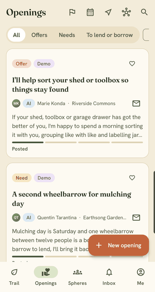

# LogoSphere

> An economy that remembers *why*.

  

LogoSphere is a place for groups (neighbourhoods, clubs, congregations, teams) to ask for help,
offer it, keep an honest record of what happened, and decide things together. It's a gift
economy: no money changes hands, nothing is for sale, and nobody is turned into a score.

**[Use it on the web](https://logosphere.earth)** · **[Download the Android app](https://github.com/ekoori/LogoSphere/releases/latest)**
(Android 8.0 or newer) · Google Play: coming soon · free, no ads, no tracking

## What you can do

- **Openings.** Offer what you can do or lend, ask for what you need, and see what your groups are
  offering right now.
- **Exchanges that remember.** When help happens, both of you confirm it, add a receipt (a photo
  too, if you like) and thank each other. It all gathers on your **Meaning Trail**.
- **Value cards and the Meaning Graph.** Say what you care about and why, and see how the people
  around you connect through what they value. Closeness is explained, never a score.
- **Spheres, alliances and projects.** Groups with their own members, values, roles,
  announcements, events and shared decisions.
- **Messages, events and places.** Talk one to one, plan get-togethers, and find what's near you,
  only if you choose to share a place.
- **Simple mode,** for anyone who wants fewer buttons, and light or dark, as you prefer.
- **Try it first.** The demo spheres are played by AI personas, clearly labelled as such, so you
  can try everything before bringing your group.
- **AI help, only when you ask.** It can help you word a value card or draw a picture for an
  opening; nothing is sent until you press its button, and AI pictures are labelled.

## Get the Android app

**From GitHub,** on the phone itself:

1. Open **[the latest release](https://github.com/ekoori/LogoSphere/releases/latest)** in your
   phone's browser.
2. Under **Assets**, tap the file whose name ends in **.apk** (such as `LogoSphere-0.4.1.apk`), not
   "Source code". The browser downloads it.
3. Open the downloaded file, from the browser's download message or from the Files app.
4. The first time, Android says your browser (or Files app) is not allowed to install apps. Tap
   **Settings**, switch on **Allow from this source**, then go back.
5. Tap **Install**. If Google Play Protect offers to scan the app first, let it.

To update, install a newer release the same way, over the old one. **From Google Play:** coming
soon. The two versions are signed differently, so switching between them means uninstalling
first; everything in your account stays on the server, and you just sign in again.

## Why LogoSphere

Every system that scales human cooperation compresses what people care about into something it
can move around. Money does it with price. Platforms do it with clicks. Each translation is
lossy, and what leaks away is the meaning. **LogoSphere is an attempt to keep it.**

Tell a community its worth is a number, and it will manufacture the number: *when a measure
becomes a target, it stops being a good measure.* So LogoSphere keeps the reasons instead. A
**value card** says what you care about and *why*, in words you'd recognise as your own, with what
it looks like in practice and what drifting from it would look like. A **receipt** says what an
exchange meant to the people in it. Nothing is summed into a ranking.

Meaning comes by three routes, and LogoSphere tells them apart:

| Mode | What it captures |
|---|---|
| **Creative** | what you make and give |
| **Experiential** | what you receive and encounter |
| **Attitudinal** | the stance you take under constraint |

The whole design turns on one distinction: **endorsed meaning** holds up when you think it over;
**performed meaning** is status play wearing meaning's clothes. Receipts over points, reasons over
scores, and "we're drifting if…" clauses over leaderboards keep the first from collapsing into the
second. The full argument is on the **[About page](https://logosphere.earth/about)** and in
**[MANIFESTO.md](MANIFESTO.md)**.

## Words you'll meet

| Word | What it is |
|---|---|
| **Opening** | An offer or a need, with the values it serves. |
| **Exchange** | The real event between people when help happens. |
| **Receipt** | A record of an exchange: the value it expressed, what it took, and the receiver's word on it. |
| **Acknowledgement** | A public thank-you: warmth, not currency. |
| **Meaning Trail** | The receipts and acknowledgements of a person or group over time. |
| **Value card** | What you care about and why, readable in ten seconds. |
| **Meaning Graph** | Everyone's value cards, drawn close where they care about close things. |
| **Sphere, alliance, project** | A group, a federation of groups, and a shared undertaking, each with its own values. |

## Privacy and safety

- **No ads, nothing sold, no tracking.** LogoSphere keeps what it needs to remember the help your
  group gives and receives, and nothing more.
- **Your data is yours.** Download everything LogoSphere holds about you, or delete your account,
  yourself: Me → Password, email, data & account in the app, or Settings on the web.
- **Report and block.** Report a person or anything they post, block anyone, and use the flag at
  the top of every screen to tell us about a problem. Reports go only to the platform's
  administrators.
- **[Privacy policy](https://logosphere.earth/privacy)** · **[Terms](https://logosphere.earth/tos)** ·
  **[Child safety standards](https://logosphere.earth/child-safety)**

## Help

Use the flag at the top of any screen, or write to
[support@logosphere.earth](mailto:support@logosphere.earth) (privacy questions:
[privacy@logosphere.earth](mailto:privacy@logosphere.earth)).

## Contributing

LogoSphere is open source under the [MIT licence](LICENSE). If you'd rather your contributions be
remembered for what they meant than counted for what they scored, you belong here: see
**[DEVELOPING.md](DEVELOPING.md)** to run it on your own computer and send a change.
